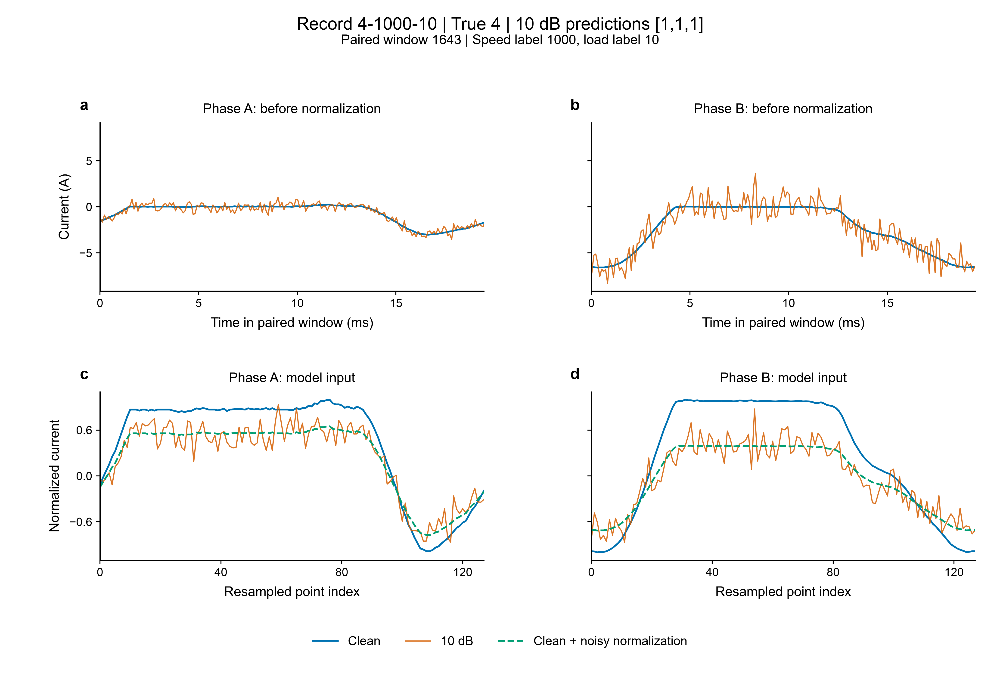

# M1固定权重的10dB诊断记录

V1运行代码提交：`69e2926ebd09f0a9b8fe8dfdebfd15aa5a7a5481`。诊断日期：2026-10-12。
固定三个M1最佳权重，种子42/43/44；88条Dev基础记录、2474个周期，五相均参与数值检查。未重训，未修改权重，未评估347条Final-Holdout。

## 原成绩与分类变化

Clean Macro-F1为96.6700 ± 0.5825%，10dB为89.9552 ± 0.3452%，差6.7148个百分点。

| 类别 | Clean F1均值% | 10dB F1均值% | 差值百分点 | 对Macro-F1差值的算术贡献 |
|---|---:|---:|---:|---:|
| Healthy | 99.60 | 96.04 | +3.56 | +0.5930 |
| OUS(A) | 93.14 | 76.51 | +16.63 | +2.7709 |
| OLS(A) | 96.17 | 87.00 | +9.17 | +1.5287 |
| OP(A) | 98.05 | 93.96 | +4.09 | +0.6819 |
| OUS(A)&OUS(B) | 95.11 | 87.84 | +7.28 | +1.2126 |
| OLS(A)&OP(C) | 97.95 | 98.38 | -0.43 | -0.0723 |

贡献定义为该类F1差值除以6。这是指标算术分解，不是错因归因比例；F1同时受其他类别误报影响。

三种子的7422次周期判决中，Clean错误176次，10dB错误613次；Clean正确而10dB错误512次，反向改正75次。10dB至少一个种子错误的唯一周期为483个，涉及69条记录。

## 新增错误混淆对

| 真值→10dB预测 | Clean正确→10dB错误判决次数 |
|---|---:|
| Healthy → OUS(A) | 87 |
| OUS(A)&OUS(B) → OUS(A) | 79 |
| Healthy → OLS(A) | 78 |
| OUS(A) → OP(A) | 64 |
| OLS(A) → Healthy | 46 |
| OUS(A) → OUS(A)&OUS(B) | 39 |
| OLS(A) → OUS(A) | 35 |

上述次数按周期×种子累加；同周期的三个种子不代表三次独立采集。完整分类对及唯一记录数见[CONFUSION_PAIRS.csv](../records/v1_noise_consistency/diagnostics_m1_snr10_v2/CONFUSION_PAIRS.csv)。

## 转速/负载标签分组

标签值沿用原Excel，不重新解释物理单位。下表按周期×种子计算错误比例，每个转速组均覆盖六类。

| 转速标签 | 记录数 | 10dB错误比例% | 记录等权平均错误比例% |
|---|---:|---:|---:|
| 300 | 10 | 9.11 | 8.44 |
| 400 | 11 | 12.20 | 11.62 |
| 500 | 12 | 9.43 | 9.01 |
| 600 | 11 | 5.15 | 4.96 |
| 700 | 12 | 7.58 | 7.18 |
| 800 | 10 | 5.28 | 5.30 |
| 900 | 11 | 7.37 | 7.41 |
| 1000 | 11 | 11.18 | 11.09 |

[完整记录及转速×负载分组](../records/v1_noise_consistency/diagnostics_m1_snr10_v2/GROUP_ERRORS.csv)。部分负载组只有1条基础记录，且故障类别组成不同；不以这些比例声称负载的独立效应。

## 归一化参数

原实现先对完整周期取极值中心 `(max+min)/2`；中心化平均绝对值小于0.2时除100，否则除最大绝对值；最后线性重采样128点。

| 类别 | 非低电流相除数比 Noisy/Clean 中位数 | 低电流相周期数 | 分支切换数 |
|---|---:|---:|---:|
| Healthy | 1.4431 | 0 | 0 |
| OUS(A) | 1.4647 | 0 | 0 |
| OLS(A) | 1.4614 | 0 | 0 |
| OP(A) | 1.4384 | 298 | 0 |
| OUS(A)&OUS(B) | 1.5196 | 0 | 0 |
| OLS(A)&OP(C) | 1.5241 | 229 | 0 |

五相×2474周期共12370个相周期，无低电流分支切换；其中OP(A)的A相298个、OLS(A)&OP(C)的C相229个均保持低电流分支。

11843个非低电流相周期在128点输入中的绝对峰值中位数：Clean=1.0000，10dB=0.9477；2164个10dB相周期的输入峰值小于0.9。极值中心和除数来自完整原分辨率周期。

[逐相中心/除数/SNR/相关系数](../records/v1_noise_consistency/diagnostics_m1_snr10_v2/PHASE_PREPROCESSING.csv)。

## 固定权重交叉输入对照

CC/NN为正式输入，均逐条复现原V1预测。CN/NC只作配对敏感性诊断，使用对照记录的归一化参数，不是部署方案或正式性能提升。

| 代号 | 电流内容 | 中心与除数来源 | Macro-F1%，均值±样本标准差 |
|---|---|---|---:|
| CC | Clean | Clean | 96.67 ± 0.58 |
| NN | 10dB | 10dB | 89.96 ± 0.35 |
| CN | Clean | 10dB | 88.71 ± 1.95 |
| NC | 10dB | Clean | 86.36 ± 3.95 |

NC的2474个周期均有输入点绝对值超过1；原CC/NN均没有。因此，NC成绩涉及输入范围变化。四种组合不能直接换算实际掉分的因果份额。

512次新增错误判决的交叉响应模式：

| CN是否错误 | NC是否错误 | 判决次数 |
|---|---|---:|
| True | False | 263 |
| False | True | 78 |
| True | True | 80 |
| False | False | 91 |

[逐种子对照分数与混淆矩阵](../records/v1_noise_consistency/diagnostics_m1_snr10_v2/PER_SEED_CONTROLS.json)，[逐周期响应](../records/v1_noise_consistency/diagnostics_m1_snr10_v2/CYCLE_ERRORS.csv)。

## 固定示例：记录4-1000-10，周期1643

真实类别4=OUS(A)&OUS(B)，周期0.597276–0.616732s。三个种子均为：CC预测4、NN预测1、CN预测1、NC预测4。

| 相 | Clean中心 | Noisy中心 | Clean除数 | Noisy除数 | 除数比 |
|---|---:|---:|---:|---:|---:|
| A | -1.391650 | -1.241155 | 1.641650 | 2.286050 | 1.392532 |
| B | -3.266650 | -2.325938 | 3.333350 | 5.979608 | 1.793873 |

蓝色为Clean，橙色为10dB；下排绿色虚线为Clean电流使用Noisy中心与除数。A/B为本示例关注相，全量诊断使用全部五相。

## 其他配对波形

- [上管→断相：0144，周期338](../figures/m1_snr10_diagnosis_v2/case_1_to_3.png)
- [下管→健康：0109，周期155](../figures/m1_snr10_diagnosis_v2/case_2_to_0.png)
- [断相保持正确：0089，周期61](../figures/m1_snr10_diagnosis_v2/case_3_to_3.png)

示例按预声明的类别对、至少两个种子Clean正确且Noisy为指定类别、最多种子一致、记录编号/周期顺序选择。示例不是总体频率估计；完整选择规则和预测见[EXAMPLES.json](../records/v1_noise_consistency/diagnostics_m1_snr10_v2/EXAMPLES.json)。

四张图有PNG600dpi及SVG/PDF。各图字号、图区对齐、文字碰撞检查均通过，[QA记录](../figures/m1_snr10_diagnosis_v2/QA_SUMMARY.json)。

## 输入与特征统计

| 状态 | Clean正确类logit间隔中位数 | 1−配对特征余弦相似度中位数 | 周期联合原电流SNR中位数dB |
|---|---:|---:|---:|
| Clean正确→Noisy错误 | 1.5523 | 0.04185 | 10.0492 |
| 两条件均正确 | 4.9450 | 0.01603 | 10.0349 |

特征为M1最后FC前的50维向量；logit间隔为真实类别减去最强竞争类别。上述为相关描述，不作为故障机制的因果证明。

新增的OUS(A)→OP(A)错误共64次周期×种子判决，对应59个唯一周期。这59个周期的A相均未进入低电流分支，10dB归一化RMS为0.4124–0.5581，中位数0.4886。真实OP(A)的298个周期，A相10dB归一化RMS为0.000202–0.000676，中位数0.000334。计算口径为[CYCLE_ERRORS.csv](../records/v1_noise_consistency/diagnostics_m1_snr10_v2/CYCLE_ERRORS.csv)中`new_error=True, label=1, noise_prediction=3`的唯一周期，与逐相表按周期索引连接。

## 源训练增强与目标10dB的低电流相对照

重放种子42/43/44的M1最佳权重实际经历的前18/6/6轮增强，不更新模型。每个种子首轮增强输入字节哈希均与原V1的PREFLIGHT记录一致。源训练集有254个Clean低电流相周期，共重放7620次相周期视图；同一周期跨轮次、种子的视图不是独立采集样本。

原增强对完整源记录按相计算电流功率并生成高斯噪声，再执行原归一化；完整记录同时包含健康段和故障段。下表仅统计原Clean已判为低电流的断相通道。

| 增强SNR dB | OP(A)的A相：低电流→普通分支/视图数 | OLS(A)&OP(C)的C相：低电流→普通分支/视图数 |
|---|---:|---:|
| 10 | 627/627（100%） | 572/572（100%） |
| 15 | 453/453（100%） | 687/687（100%） |
| 20 | 216/317（68.14%） | 570/648（87.96%） |
| 25 | 0/656（0%） | 9/760（1.18%） |
| 30 | 0/760（0%） | 0/503（0%） |
| 35 | 0/477（0%） | 0/380（0%） |
| 40 | 0/520（0%） | 0/260（0%） |

| 条件 | OP(A)的A相归一化RMS中位数 | OLS(A)&OP(C)的C相归一化RMS中位数 |
|---|---:|---:|
| 源训练10dB增强 | 0.312229（627次视图） | 0.307340（572次视图） |
| 目标数据提供的10dB | 0.000334（298个周期） | 0.000492（229个周期） |

另按每条记录的健康段0.1–0.45s与已选故障周期覆盖段计算配对差分噪声RMS。同一断相通道的“故障段噪声RMS/健康段噪声RMS”中位数：源10dB增强=1.000514（66次记录×轮次×种子），目标提供的10dB=0.022618（35条记录）。源和目标记录的工况、片段及采集来源不同，不将两组视图当作独立配对样本。

数据发布者的噪声生成算法尚未核实；以上记录不据此指定其算法类型。训练增强输入与目标输入的分支及幅度对照不等于重新训练后的性能结果，也不能分摊6.7148个百分点下降的因果份额。完整重放统计、首轮输入及脚本哈希见[SOURCE_TARGET_NOISE_CHECK.json](../records/v1_noise_consistency/diagnostics_m1_snr10_v2/SOURCE_TARGET_NOISE_CHECK.json)。

## 代码与核验

- [诊断代码](../scripts/diagnose_m1_snr10.py)：原预测复现、独立展开预处理、固定权重四组合、分组错误。
- [补充统计](../scripts/summarize_m1_diagnosis.py)：交叉敏感模式及重采样峰值，不调用模型。
- [增强重放核对](../scripts/probe_m1_noise_preprocessing.py)：沿用原随机数流，重放最佳权重训练前缀，并检查低电流相与健康/故障段噪声幅度。
- [波形绘图](../scripts/plot_m1_diagnosis.py)：读取诊断示例数组，输出可编辑矢量图；图区检查助手通过`--qa-helper-dir`传入。
- [汇总与权重哈希](../records/v1_noise_consistency/diagnostics_m1_snr10_v2/SUMMARY.json)。
- [发布文件哈希](../records/v1_noise_consistency/diagnostics_m1_snr10_v2/PUBLICATION_MANIFEST.json)。

独立核验逐条比对了三个种子的Clean/10dB六组正式预测，并从逐周期真值及预测重新计算四种输入×三个种子的12组F1与混淆矩阵；结果全部一致。7422次判决、12370个相周期、512次新增错误和1199次源10dB低电流分支切换已复算。服务器三个最佳权重的哈希与诊断前一致；源增强重放JSON的服务器与发布副本字节哈希一致。

首次诊断因指标容器初始化类型错误退出；修正后在新的v2目录执行完成，失败目录保留。原始实验权重、预测及训练配置未修改。

原始MAT、选定示例的私有NPZ电流数组和权重不发布；本记录仅包含统计、代码、图片与来源元数据。
